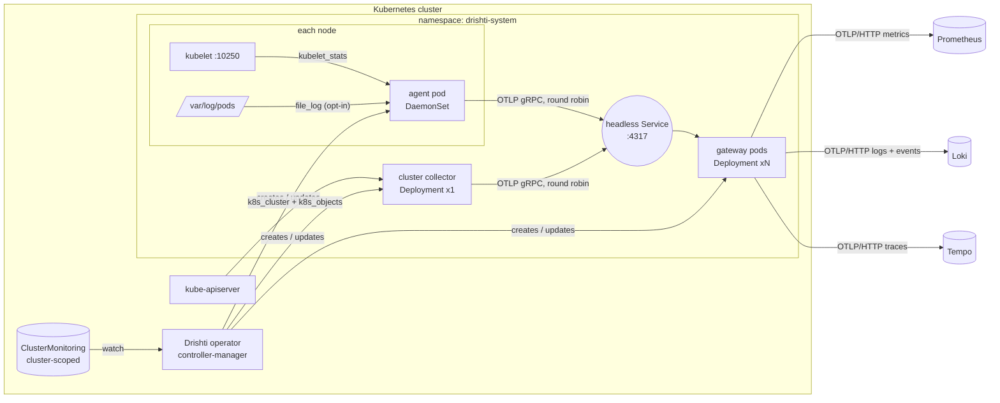
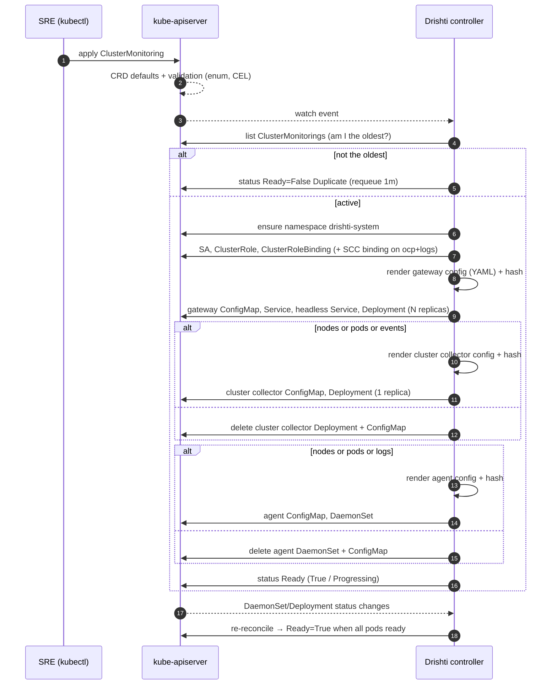

# Drishti operator: `ClusterMonitoring`

## Contents

0. [Quick start](#quick-start)
   - [Quick start behind Zscaler](#quick-start-behind-zscaler)
1. [Prerequisites](#1-prerequisites)
2. [How this project was scaffolded](#2-how-this-project-was-scaffolded)
3. [Build and test](#3-build-and-test)
4. [Run on a local kind cluster](#4-run-on-a-local-kind-cluster)
5. [Send data to a real backend](#5-send-data-to-a-real-backend)
6. [Design document](#6-design-document)
7. [How it works: reconcile loop](#7-how-it-works-reconcile-loop)
8. [API reference](#8-api-reference)
9. [Troubleshooting](#9-troubleshooting)
10. [Project layout](#10-project-layout)

---

A Kubernetes operator built with [Kubebuilder](https://book.kubebuilder.io) that sets up logs and metrics collection for a whole cluster from one small custom resource.

You write this:

```yaml
apiVersion: monitoring.drishti.io/v1alpha1
kind: ClusterMonitoring
metadata:
  name: hlr-gke-prod
spec:
  platform: gke
  clusterName: hlr-gke-prod
```

Drishti then creates:

| What | Kind | Purpose |
|---|---|---|
| `<name>-agent` | DaemonSet (one pod per node) | Node + pod + container metrics from the kubelet; container logs (opt-in) |
| `<name>-cluster-collector` | Deployment (always 1 replica) | Cluster state metrics and Kubernetes events, read from the API server |
| `<name>-gateway` | Deployment (`spec.gateway.replicas`, default 2) + Service + headless Service | Receives data from the agents and the cluster collector, and is the only component that talks to the backends |
| `<name>-collector` | ServiceAccount + ClusterRole + ClusterRoleBinding | Read-only API access for the agent and the cluster collector |

The full annotated example is [yaml/cluster.yml](yaml/cluster.yml).

---

## Quick start

Local development from zero to dashboards. Run every command from the **root of the project**, with the tools in [1. Prerequisites](#1-prerequisites) installed and Podman running. Behind Zscaler (or any proxy that inspects HTTPS), create the cluster as described in [Quick start behind Zscaler](#quick-start-behind-zscaler) instead of step 1.

**Terminal 1: cluster, backends, operator**

Go to the root of the project, then:

```bash
# 0. kind uses Podman instead of Docker
export KIND_EXPERIMENTAL_PROVIDER=podman

# 1. Local cluster: 1 control plane + 2 workers. This also creates the "kind" network.
kind create cluster --name drishti --config yaml/kind-config.yaml

# 2. Prometheus, Loki, Tempo and Grafana on the "kind" network (data is in memory only)
podman compose -f demo/infrastructure/docker-compose.yaml up -d

# 3. Point the operator at those backends
export DRISHTI_METRICS_ENDPOINT=http://prometheus:9090/api/v1/otlp DRISHTI_LOGS_ENDPOINT=http://loki:3100/otlp DRISHTI_TRACES_ENDPOINT=http://tempo:4318

# 4. Install the CRD and run the operator from source (keep this terminal open)
make install run
```

**Terminal 2: turn on monitoring and look at the data**

Go to the root of the project, then:

```bash
# 5. Ask for monitoring of this cluster
kubectl apply -f yaml/cluster.yml

# 6. Wait until READY is True (about a minute: images are pulled first)
kubectl get cmon -w

# 7. The collectors: 3 agents (one per node) + 1 cluster collector + 2 gateways
kubectl -n drishti-system get pods -o wide

# 8. Metrics have reached Prometheus
curl -s 'http://localhost:9090/api/v1/query?query=count(k8s_node_cpu_usage)' ; echo
```

Open **Grafana at http://localhost:3000** (no login) → **Explore**:

- Prometheus: `k8s_node_memory_working_set_bytes`
- Loki, Kubernetes events (needs `events: true` in the CR): `{service_name="kubernetes-events"}`
- Loki, container logs (needs `logs: true` in the CR): `{k8s_namespace_name="kube-system"}`

**After changing Go code:** press Ctrl+C in terminal 1, then `make run` again. After changing `*_types.go`, run `make manifests generate install run`.

**Clean up**

```bash
kubectl delete -f yaml/cluster.yml                              # removes every collector
podman compose -f demo/infrastructure/docker-compose.yaml down  # stops the backends, data is discarded
kind delete cluster --name drishti
```

The rest of this README explains each step in detail: [4. Run on a local kind cluster](#4-run-on-a-local-kind-cluster) and [5.1 Local stack](#51-local-stack-prometheus-loki-tempo-and-grafana).

---

## Quick start behind Zscaler

Zscaler inspects HTTPS by replacing every site's certificate with one signed by the Zscaler root certificate. Podman and the kind nodes don't trust that certificate, so image pulls fail with `x509: certificate signed by unknown authority`. The steps below make both trust it. Steps 1 to 4 are done **once**; after that, step 5 replaces step 1 of the [Quick start](#quick-start) every time you create the cluster.

Go to the root of the project, then:

**1. Save the Zscaler root certificate in PEM format as `~/zscaler.crt`.** Export it from the system keychain, or ask IT for it:

```bash
security find-certificate -a -c "Zscaler" -p /Library/Keychains/System.keychain > ~/zscaler.crt
```

If you were given a `.cer` file instead, convert it (it is often binary DER):

```bash
openssl x509 -inform der -in ~/Downloads/ZscalerRootCertificate.cer -out ~/zscaler.crt
```

Check it. This must print `subject=... Zscaler ...`:

```bash
openssl x509 -in ~/zscaler.crt -noout -subject
```

**2. Build a CA bundle: the system's public CAs plus Zscaler.** The kind nodes will use this file as their list of trusted CAs:

```bash
cat "$(ls /etc/ssl/cert.pem /etc/ssl/certs/ca-certificates.crt 2>/dev/null | head -1)" ~/zscaler.crt > ~/.kind-ca-bundle.crt
```

**3. Trust Zscaler in the Podman VM.** Only needed when Podman runs its containers in a VM (`podman machine`). The certificate stays there across restarts; redo this step only after `podman machine rm`:

```bash
podman machine ssh "sudo tee /etc/pki/ca-trust/source/anchors/zscaler.crt > /dev/null && sudo update-ca-trust" < ~/zscaler.crt
```

**4. Create `yaml/kind-config-zscaler.yml`.** Same cluster as `yaml/kind-config.yaml`, plus the bundle mounted into every node as its trusted CA list:

```bash
cat > yaml/kind-config-zscaler.yml <<EOF
# Generated from the README (Quick start behind Zscaler). Not committed:
# it contains your home directory path.
kind: Cluster
apiVersion: kind.x-k8s.io/v1alpha4
nodes:
  - role: control-plane
    extraMounts: &ca
      - hostPath: $HOME/.kind-ca-bundle.crt
        containerPath: /etc/ssl/certs/ca-certificates.crt
        readOnly: true
  - role: worker
    extraMounts: *ca
  - role: worker
    extraMounts: *ca
EOF
```

Run it exactly like this rather than copying the YAML into a file by hand. kind doesn't expand variables, so the file must contain your real home path, and the shell writes it in place of `$HOME` here. Check it: the `hostPath` must start with your home directory, not `$HOME`:

```bash
grep hostPath yaml/kind-config-zscaler.yml
```

The file is listed in `.gitignore`, so it is never pushed.

**5. Create the cluster from it** (instead of step 1 of the Quick start):

```bash
export KIND_EXPERIMENTAL_PROVIDER=podman
kind create cluster --name drishti --config yaml/kind-config-zscaler.yml
```

Image pulls now work on every node, with no further steps. Check one:

```bash
podman exec drishti-control-plane crictl pull docker.io/otel/opentelemetry-collector-contrib:0.165.0
```

Then continue with step 2 of the [Quick start](#quick-start). When Zscaler rotates its root certificate (rare), redo steps 1 to 3 and recreate the cluster.

---

## 1. Prerequisites

| Tool | Version used | Check |
|---|---|---|
| Go | 1.26+ (tested with 1.27.3) | `go version` |
| Kubebuilder | v4.16.0 | `kubebuilder version` |
| kind | any recent | `kind version` |
| kubectl | matches cluster (1.37) | `kubectl version --client` |
| Podman | with `podman compose` working | `podman info` |
| make | GNU make | `make --version` |

### 1.1 Put Go on the PATH

Tools installed with `go install` (and by this project's Makefile) go into `$(go env GOPATH)/bin`. Make sure that directory is on the PATH, for example in your shell profile:

```bash
export PATH="$(go env GOPATH)/bin:$PATH"
go version
```

### 1.2 Install kubectl

```bash
curl -LO "https://dl.k8s.io/release/$(curl -Ls https://dl.k8s.io/release/stable.txt)/bin/$(go env GOOS)/$(go env GOARCH)/kubectl"
sudo install -m 0755 kubectl /usr/local/bin/kubectl && rm kubectl
kubectl version --client
```

### 1.3 Set up Podman for kind

kind runs each Kubernetes node as a container. Tell it to use Podman, and add the line to your shell profile so it applies to every terminal:

```bash
export KIND_EXPERIMENTAL_PROVIDER=podman
```

If Podman runs its containers in a VM, start it first:

```bash
podman machine start
```

`podman compose` hands off to a compose provider, so one must be installed (for example `podman-compose`). Check:

```bash
podman compose version
```

### 1.4 Install kind and kubebuilder (if missing)

```bash
# kind
curl -Lo ./kind "https://kind.sigs.k8s.io/dl/latest/kind-$(go env GOOS)-$(go env GOARCH)"
sudo install -m 0755 kind /usr/local/bin/kind && rm kind

# kubebuilder
curl -L -o kubebuilder "https://go.kubebuilder.io/dl/latest/$(go env GOOS)/$(go env GOARCH)"
sudo install -m 0755 kubebuilder /usr/local/bin/kubebuilder && rm kubebuilder
```

---

## 2. How this project was scaffolded

You don't need to run these again. They are recorded so the project can be rebuilt from nothing. From the root of the project:

```bash
# Go module + manager + kustomize config. Project name "drishti" gives the
# namespace drishti-system and the name prefix drishti-.
kubebuilder init \
  --domain drishti.io \
  --repo github.com/hdfc/drishti-operator \
  --project-name drishti

# Cluster-scoped API (one per cluster, no namespace) + controller.
kubebuilder create api \
  --group monitoring --version v1alpha1 --kind ClusterMonitoring \
  --namespaced=false --resource --controller
```

That produces `apiVersion: monitoring.drishti.io/v1alpha1, kind: ClusterMonitoring`, which matches [yaml/cluster.yml](yaml/cluster.yml).

The hand-written code is:

- [api/v1alpha1/clustermonitoring_types.go](api/v1alpha1/clustermonitoring_types.go): the spec/status schema, validation and defaults
- [internal/controller/](internal/controller/): the reconciler and everything it generates
- [cmd/main.go](cmd/main.go): install-time flags and the cache filter
- [config/manager/manager.yaml](config/manager/manager.yaml): env vars for the defaults, plus the namespace Pod Security label

---

## 3. Build and test

From the root of the project:

```bash
make manifests   # regenerate CRD + RBAC from the // +kubebuilder markers
make generate    # regenerate zz_generated.deepcopy.go
make build       # go build -> bin/manager
make test        # unit tests + envtest (real kube-apiserver + etcd, no nodes)
```

`make test` downloads envtest binaries into `bin/` on first run. Expected result:

```
ok  github.com/hdfc/drishti-operator/internal/controller  ... coverage: 82% of statements
```

What the tests cover:

- **CRD defaulting**: an empty `collect: {}` becomes `nodes/pods/events: true, logs: false`, and `collectionInterval: 30s`
- **Reconcile**: DaemonSet, Deployment, Service, ConfigMaps, ClusterRole/Binding are created with owner references; `Ready=False/Progressing` is reported (envtest runs no pods)
- **Toggles**: turning off nodes, pods and logs deletes the agent DaemonSet
- **Singleton**: a second ClusterMonitoring is marked `DuplicateClusterMonitoring` and creates nothing
- **Config rendering**: pipelines per toggle, self-log exclusion, the debug-exporter fallback, per-signal destination override

---

## 4. Run on a local kind cluster

### 4.1 Create the cluster

Behind Zscaler, use `yaml/kind-config-zscaler.yml` instead (see [Quick start behind Zscaler](#quick-start-behind-zscaler)).

```bash
export KIND_EXPERIMENTAL_PROVIDER=podman
kind create cluster --name drishti --config yaml/kind-config.yaml
kubectl get nodes          # 1 control-plane + 2 workers
```

### 4.2 Option A: run the operator from your shell (fastest loop)

```bash
make install               # applies the CRD only
make run                   # runs the controller locally against ~/.kube/config
```

The controller creates the `drishti-system` namespace itself if it is missing. Leave it running and open a second terminal for the next steps.

### 4.3 Option B: deploy the operator into the cluster

Podman names local images `localhost/<name>`, so use that name everywhere. `kind load` reads the image from an archive file:

```bash
make docker-build CONTAINER_TOOL=podman IMG=localhost/drishti-operator:dev
podman save -o /tmp/drishti-operator.tar localhost/drishti-operator:dev
kind load image-archive /tmp/drishti-operator.tar --name drishti
make deploy IMG=localhost/drishti-operator:dev

kubectl -n drishti-system get deploy drishti-controller-manager
kubectl -n drishti-system logs deploy/drishti-controller-manager -f
```

### 4.4 Apply the ClusterMonitoring

```bash
kubectl apply -f yaml/cluster.yml
# or, with logs enabled:
# kubectl apply -f config/samples/monitoring_v1alpha1_clustermonitoring.yaml
```

### 4.5 Verify

```bash
kubectl get clustermonitoring          # short name: kubectl get cmon
# NAME           PLATFORM   CLUSTER        ENV    READY   AGE
# hlr-gke-prod   gke        hlr-gke-prod   prod   True    1m

kubectl get cmon hlr-gke-prod -o wide  # adds the status message column
kubectl get cmon hlr-gke-prod -o jsonpath='{.status.conditions}' ; echo

kubectl -n drishti-system get ds,deploy,svc,cm,sa -l app.kubernetes.io/managed-by=drishti
kubectl get clusterrole,clusterrolebinding -l app.kubernetes.io/managed-by=drishti

# The rendered OpenTelemetry configs
kubectl -n drishti-system get cm hlr-gke-prod-agent             -o jsonpath='{.data.config\.yaml}'
kubectl -n drishti-system get cm hlr-gke-prod-cluster-collector -o jsonpath='{.data.config\.yaml}'
kubectl -n drishti-system get cm hlr-gke-prod-gateway           -o jsonpath='{.data.config\.yaml}'
```

With no backend configured, the gateway uses the OTel `debug` exporter, so data shows up in its logs. With several replicas, `--prefix` shows which pod printed each line:

```bash
kubectl -n drishti-system logs -l app.kubernetes.io/component=gateway --prefix -f
# ... Metrics {"kind": "exporter", "data_type": "metrics", "name": "debug", "resource metrics": 12, ...}
# ... Logs    {"kind": "exporter", "data_type": "logs",    "name": "debug", "log records": 7, ...}
```

### 4.6 Try changes and see the operator react

```bash
# Turn on logs: the agent rolls (config hash changes) and mounts /var/log/pods
kubectl patch cmon hlr-gke-prod --type merge -p '{"spec":{"collect":{"logs":true}}}'

# Turn off everything node-local: the agent DaemonSet is deleted
kubectl patch cmon hlr-gke-prod --type merge -p '{"spec":{"collect":{"nodes":false,"pods":false,"logs":false}}}'

# Scale the gateway: more replicas share the export load
kubectl patch cmon hlr-gke-prod --type merge -p '{"spec":{"gateway":{"replicas":3}}}'

# Turn off cluster state and events: the cluster collector is deleted (the gateway stays)
kubectl patch cmon hlr-gke-prod --type merge -p '{"spec":{"collect":{"nodes":false,"pods":false,"events":false}}}'

# Deleting a child is self-healing: it is recreated within seconds
kubectl -n drishti-system delete deploy hlr-gke-prod-gateway

# clusterName is immutable (CEL rule)
kubectl patch cmon hlr-gke-prod --type merge -p '{"spec":{"clusterName":"other"}}'
# The ClusterMonitoring "hlr-gke-prod" is invalid: spec.clusterName: Invalid value: "string": clusterName is immutable
```

### 4.7 Clean up

```bash
kubectl delete -f yaml/cluster.yml     # garbage-collects every child (owner references)
make undeploy                          # if you used Option B
make uninstall                         # removes the CRD
kind delete cluster --name drishti
```

### 4.8 Check the collector configs offline (optional)

To check the generated configs against the exact collector version without a cluster, download `otelcol-contrib` v0.165.0 and validate them:

```bash
mkdir -p ~/otel && cd ~/otel
curl -sSLO "https://github.com/open-telemetry/opentelemetry-collector-releases/releases/download/v0.165.0/otelcol-contrib_0.165.0_$(go env GOOS)_$(go env GOARCH).tar.gz"
tar xzf otelcol-contrib_0.165.0_*.tar.gz otelcol-contrib
kubectl -n drishti-system get cm hlr-gke-prod-gateway -o jsonpath='{.data.config\.yaml}' > gateway.yaml
./otelcol-contrib validate --config=gateway.yaml
```

---

## 5. Send data to a real backend

Backends are install-time settings, the "Helm values". SREs normally don't set them in the CR.

| Signal | Env var on the manager | Flag | Example |
|---|---|---|---|
| metrics | `DRISHTI_METRICS_ENDPOINT` | `--default-metrics-endpoint` | `http://prometheus:9090/api/v1/otlp` |
| logs | `DRISHTI_LOGS_ENDPOINT` | `--default-logs-endpoint` | `http://loki:3100/otlp` |
| traces | `DRISHTI_TRACES_ENDPOINT` | `--default-traces-endpoint` | `http://tempo:4318` |
| environment | `DRISHTI_DEFAULT_ENVIRONMENT` | `--default-environment` | `prod` |
| collector image | `DRISHTI_COLLECTOR_IMAGE` | `--collector-image` | `otel/opentelemetry-collector-contrib:0.165.0` |

Set them permanently in [config/manager/manager.yaml](config/manager/manager.yaml), or on a running install:

```bash
kubectl -n drishti-system set env deploy/drishti-controller-manager \
  DRISHTI_METRICS_ENDPOINT=http://prometheus:9090/api/v1/otlp \
  DRISHTI_LOGS_ENDPOINT=http://loki:3100/otlp \
  DRISHTI_TRACES_ENDPOINT=http://tempo:4318
```

With `make run`, export the same variables before starting.

**Precedence, per signal:** `spec.destination.<signal>` in the CR, then the install-time default, then the `debug` exporter (stdout). One cluster can override only `metrics` and keep the default `logs`.

**Backend notes**

- *Prometheus 3.x*: start it with `--web.enable-otlp-receiver`; the base URL is `/api/v1/otlp` and the collector appends `/v1/metrics`. The gateway copies `k8s.cluster.name` and `deployment.environment` onto every datapoint, so they appear as `k8s_cluster_name` / `deployment_environment` labels. Pod, namespace and node names are resource attributes: list them under `otlp.promote_resource_attributes` in `prometheus.yml` to get them as labels.
- *Loki 3.x*: native OTLP at `/otlp`. Needs `allow_structured_metadata: true` (the default with schema v13).
- *Tempo*: OTLP/HTTP on port 4318; the collector appends `/v1/traces`. Drishti collects no traces (application monitoring isn't part of cluster monitoring), so this endpoint is optional.

### 5.1 Local stack: Prometheus, Loki, Tempo and Grafana

[demo/infrastructure/](demo/infrastructure/) runs all four backends with `podman compose` next to the kind cluster:

| Service | Receives | Browser |
|---|---|---|
| Prometheus | metrics (OTLP) | http://localhost:9090 |
| Loki | logs and Kubernetes events (OTLP) | http://localhost:3100/ready |
| Tempo | traces (OTLP) | http://localhost:3200/ready |
| Grafana | nothing, it queries the other three | http://localhost:3000 (no login) |

No extra OpenTelemetry Collector runs in Compose: the Drishti gateway is already one and sends OTLP straight to the backends.

Every service joins the `kind` network. The kind nodes use that network's DNS, so the gateway reaches the services by name (`prometheus`, `loki`, `tempo`). The `kind` network exists only after a kind cluster is created, so start the cluster first.

```bash
# 1. Cluster (4.1), then the backends
podman compose -f demo/infrastructure/docker-compose.yaml up -d
podman compose -f demo/infrastructure/docker-compose.yaml ps     # all "running" / tempo-init "exited (0)"

# 2. Operator with the backends as install-time defaults (Option A)
export DRISHTI_METRICS_ENDPOINT=http://prometheus:9090/api/v1/otlp
export DRISHTI_LOGS_ENDPOINT=http://loki:3100/otlp
export DRISHTI_TRACES_ENDPOINT=http://tempo:4318
make install run
```

For Option B, use the `kubectl set env` command above after `make deploy`. If the operator is already running, restart it with the variables set; the gateway rolls to the new config on the next reconcile.

Check that data arrives:

```bash
# The gateway config now has otlp_http exporters instead of debug
kubectl -n drishti-system get cm hlr-gke-prod-gateway -o jsonpath='{.data.config\.yaml}' | grep -A1 otlp_http

# The gateways can reach the backends (no "connection refused" / "no such host")
kubectl -n drishti-system logs -l app.kubernetes.io/component=gateway --prefix | grep -i error

# Metrics in Prometheus
curl -s 'http://localhost:9090/api/v1/query?query=count(k8s_node_cpu_usage)' ; echo
```

Then in Grafana (http://localhost:3000 → **Explore**):

- **Prometheus**: `k8s_node_memory_working_set_bytes`, or `sum by (k8s_pod_name) (k8s_pod_cpu_usage{k8s_namespace_name="drishti-system"})`
- **Loki**, everything from this cluster: `{k8s_cluster_name="hlr-gke-prod"}`. Only Kubernetes events (`collect.events: true`): `{service_name="kubernetes-events"}`, or warnings only: `{service_name="kubernetes-events"} | json | object_type="Warning"`. Container logs (`collect.logs: true`) are named after their container, e.g. `{service_name="coredns"}`.

Stop the stack with `podman compose -f demo/infrastructure/docker-compose.yaml down`. Nothing is persisted: every service keeps its data in `tmpfs` (memory), so it is discarded whenever a container stops, including when Podman (or its VM) restarts. The containers come back empty on their own (`restart: unless-stopped`); Grafana re-provisions its datasources on every start.

---

## 6. Design document

### 6.1 Goal

Give an SRE one object per cluster that turns on standard logs and metrics collection, with good defaults and no knowledge of backend URLs or OTel internals. Keep platform differences (GKE, EKS, OpenShift) inside the operator.

**Non-goals for v1alpha1:** dashboards and alerts, application monitoring (instrumenting apps, OTel SDKs, receiving app metrics, logs or traces), tracing collection from nodes, multi-tenancy inside one cluster.

### 6.2 Architecture



**How it works, in short**

> The operator creates an **agent DaemonSet**, a **cluster collector Deployment** (1 replica) and a **gateway Deployment** (N replicas). All three run the OpenTelemetry Collector **contrib image**, each with a **config the operator generates** (in a ConfigMap), plus RBAC and Services.
>
> - **Agents** **poll** their node's kubelet every 30s for CPU, memory, disk and network (and tail logs if enabled), then send it to the gateway.
> - The **cluster collector** uses **list + watch** on the API server to keep a live copy of cluster **objects**. It turns that copy into **state metrics** every 30s, and turns **events** into logs as they arrive, then sends them to the gateway.
> - The **gateways** receive everything, add the cluster labels and send it to Prometheus, Loki and Tempo. They hold no cluster state, so there can be as many as the load needs.
>
> In every collector, data goes through **processors** (`memory_limiter` → labels → `batch`, which waits up to 5s or 8192 items), then gets **exported**: agents and the cluster collector to the gateways, and the gateways to Prometheus, Loki and Tempo.

```
kubelet ────poll 30s─────► agents (1 per node) ─────────┐
                                                        │ OTLP gRPC, round robin
API server ──list+watch──► cluster collector (1) ───────┤ over all gateway pods
              (objects → metrics every 30s,             ▼
               events → logs at once)          gateway (N replicas)
                                                        │ memory_limiter → add cluster labels → batch
                                                        ▼
                                              Prometheus / Loki / Tempo
```

### 6.3 The three collectors

All three run the **OpenTelemetry Collector contrib** image. They differ only in the config the operator writes.

**Agent (DaemonSet), node-local work only**

| Receiver | Enabled by | Produces |
|---|---|---|
| `kubelet_stats` | `collect.nodes` (group `node`), `collect.pods` (groups `pod`, `container`) | CPU, memory, filesystem and network per node, pod and container, read from the local kubelet at `https://$K8S_NODE_IP:10250` using the SA token |
| `file_log` | `collect.logs` | Every container log line under `/var/log/pods/*/*/*.log`, parsed by the `container` operator (docker / containerd / cri-o). The agent's own logs are excluded to prevent a feedback loop. |

Processors: `memory_limiter` → `k8s_attributes` (adds deployment / statefulset / daemonset / job names, watching only pods on its own node) → `batch`. Exporter: `otlp_grpc/gateway`, OTLP gRPC to the gateway (see "Load balancing" below).

**Cluster collector (Deployment, always exactly 1 replica), cluster-wide state from the API server**

Created when `collect.nodes`, `collect.pods` or `collect.events` is on; deleted when all three are off.

| Receiver | Enabled by | Produces |
|---|---|---|
| `k8s_cluster` | `collect.nodes` or `collect.pods` | Object state: pod phase, container restarts, node conditions, deployment desired/available, and more. `distribution: openshift` on OCP adds ClusterResourceQuota metrics. |
| `k8s_objects` | `collect.events` | Kubernetes events (`events.k8s.io`) in watch mode, as log records. `DELETED` watch records are dropped: they are Kubernetes expiring old events (about 1h TTL), not something that happened. |

Processors: `memory_limiter` → `batch`. Events have their own pipeline, `logs/events`, with two extra processors: `resource/events` sets `service.name: kubernetes-events` (without it Loki files them under `unknown_service`), and `transform/events` removes `metadata.managedFields`, which is API server bookkeeping. Exporter: `otlp_grpc/gateway`, same as the agents.

It uses the `Recreate` rollout: on a config change the old pod stops before the new one starts, so there is never a second copy sending the same metrics and events.

**Gateway (Deployment, `spec.gateway.replicas`, default 2), egress only**

| Receiver | Enabled by | Produces |
|---|---|---|
| `otlp` | always | Receives data from the agents and the cluster collector (4317 gRPC) |

Processors: `memory_limiter` → `resource/cluster` (upserts `k8s.cluster.name`, `deployment.environment`) → `transform/labels` (metrics only: copies them onto each datapoint) → `batch`. Exporters: one `otlp_http/<signal>` per configured backend, otherwise `debug`.

The gateway never calls the Kubernetes API, so it runs **without a ServiceAccount token** and has no RBAC. Rolling updates start a new pod before stopping an old one (`maxUnavailable: 0`), and replicas are spread across nodes.

**Load balancing**

The agents and the cluster collector send to `dns:///<name>-gateway-headless.<ns>.svc:4317` with `balancer_name: round_robin`. The headless Service returns the IP of every ready gateway pod, and the gRPC client spreads requests over all of them. A normal Service would not do that: gRPC keeps one long-lived connection, so each agent would stick to a single gateway pod.

When you add replicas, collectors pick up the new pods the next time they re-resolve the DNS name, which happens when a connection drops or after a few minutes.

**Why this split?**

- `k8s_cluster` and `k8s_objects` must run **once per cluster**. Two copies would double every cluster metric and event, so the cluster collector is a fixed singleton.
- Exporting is **stateless**, so the gateway can run as many replicas as the load needs, and losing one gateway pod doesn't stop data flowing.
- Only the gateway knows backend URLs and credentials, and cluster labels are stamped in one place.

### 6.4 Metrics collected

Everything below is collected every `collectionInterval` (default 30s). The lists match the collector image the operator deploys (`otel/opentelemetry-collector-contrib:0.165.0`). Each receiver's full reference is in its `documentation.md` upstream: [kubelet_stats](https://github.com/open-telemetry/opentelemetry-collector-contrib/blob/v0.165.0/receiver/kubeletstatsreceiver/documentation.md), [k8s_cluster](https://github.com/open-telemetry/opentelemetry-collector-contrib/blob/v0.165.0/receiver/k8sclusterreceiver/documentation.md).

**Labels on every metric**

| Label | Added by |
|---|---|
| `k8s.cluster.name`, `deployment.environment` | gateway (`resource/cluster`, copied onto each datapoint by `transform/labels`) |
| `k8s.node.name`, `k8s.namespace.name`, `k8s.pod.name`, `k8s.pod.uid`, `k8s.container.name` | the receiver, where the metric is about that object |
| `k8s.deployment.name`, `k8s.statefulset.name`, `k8s.daemonset.name`, `k8s.job.name`, `k8s.cronjob.name` | agent (`k8s_attributes`), for pod and container metrics |

#### Agent (DaemonSet): usage, from each node's kubelet

Receiver `kubelet_stats`. `collect.nodes` turns on the **Node** column, and `collect.pods` turns on the **Pod** and **Container** columns. Every node reports only its own node, pods and containers.

| Metric (`<prefix>` = `k8s.node`, `k8s.pod` or `container`) | Unit | Node | Pod | Container | Meaning |
|---|---|:-:|:-:|:-:|---|
| `<prefix>.cpu.usage` | cores | ✓ | ✓ | ✓ | CPU in use right now, for example `0.25` = a quarter of one core. |
| `<prefix>.cpu.time` | seconds, cumulative | ✓ | ✓ | ✓ | Total CPU time used since start. Use `rate()` on it. |
| `<prefix>.memory.usage` | bytes | ✓ | ✓ | ✓ | All memory in use, including page cache |
| `<prefix>.memory.working_set` | bytes | ✓ | ✓ | ✓ | Memory that can't be freed. **This is what the OOM killer and `kubectl top` use.** |
| `<prefix>.memory.rss` | bytes | ✓ | ✓ | ✓ | Anonymous memory (heap and stack), excluding cache |
| `<prefix>.memory.available` | bytes | ✓ | ✓ | ✓ | Memory left before the limit (pod/container) or node capacity |
| `<prefix>.memory.page_faults` | count | ✓ | ✓ | ✓ | Page faults |
| `<prefix>.memory.major_page_faults` | count | ✓ | ✓ | ✓ | Page faults that had to read from disk |
| `<prefix>.filesystem.usage` | bytes | ✓ | ✓ | ✓ | Disk used (node root disk, pod volumes and logs, container writable layer) |
| `<prefix>.filesystem.capacity` | bytes | ✓ | ✓ | ✓ | Disk size |
| `<prefix>.filesystem.available` | bytes | ✓ | ✓ | ✓ | Disk free |
| `<prefix>.network.io` | bytes, cumulative | ✓ | ✓ | | Bytes sent and received. Labels: `interface`, `direction` (`receive` / `transmit`). |
| `<prefix>.network.errors` | count, cumulative | ✓ | ✓ | | Network errors. Same labels. |

That's 13 node, 13 pod and 11 container metrics.

**Deliberately not collected**

| Metric | Why |
|---|---|
| `*.cpu.utilization` | Removed upstream (it was a misnamed duplicate of `*.cpu.usage`: cores, not a 0 to 1 ratio). |
| `k8s.volume.*` | The `volume` metric group isn't enabled. Pod volume usage is already in `k8s.pod.filesystem.*`. |
| `*_limit_utilization`, `*_request_utilization`, `*.node.utilization`, `*.uptime` | Optional upstream and off by default. They can be computed from `*.cpu.usage` / `*.memory.working_set` and the `k8s_cluster` limit and request metrics below. |

#### Cluster collector (Deployment): state, from the API server

Receiver `k8s_cluster`, turned on by `collect.nodes` **or** `collect.pods`. It reads object specs and statuses from the API server, so it reports what Kubernetes *wants* and *thinks*, not what is being used. It reports on the whole cluster, all namespaces.

| Object | Metrics | Meaning |
|---|---|---|
| Node | `k8s.node.condition_ready`, `k8s.node.condition_memory_pressure`, `k8s.node.condition_disk_pressure`, `k8s.node.condition_pid_pressure` | `1` = condition is True, `0` = False, `-1` = Unknown. Chosen by `node_conditions_to_report` in the cluster collector config. |
| Namespace | `k8s.namespace.phase` | `1` = Active, `0` = Terminating |
| Pod | `k8s.pod.phase` | `1` Pending, `2` Running, `3` Succeeded, `4` Failed, `5` Unknown |
| Container | `k8s.container.ready` | `1` = passing its readiness probe |
| | `k8s.container.restarts` | Restart count. Treat it as "0 vs. more than 0": kubelet can reset it. |
| | `k8s.container.cpu_request`, `k8s.container.cpu_limit` | From the pod spec, in cores |
| | `k8s.container.memory_request`, `k8s.container.memory_limit` | From the pod spec, in bytes |
| | `k8s.container.ephemeralstorage_request` / `_limit`, `k8s.container.storage_request` / `_limit` | From the pod spec, in bytes (only if set) |
| Deployment | `k8s.deployment.desired`, `k8s.deployment.available` | Pods wanted vs. pods ready |
| ReplicaSet | `k8s.replicaset.desired`, `k8s.replicaset.available` | Same, per ReplicaSet |
| ReplicationController | `k8s.replication_controller.desired`, `k8s.replication_controller.available` | Same, for the legacy kind |
| StatefulSet | `k8s.statefulset.desired_pods`, `k8s.statefulset.ready_pods`, `k8s.statefulset.current_pods`, `k8s.statefulset.updated_pods` | Pods wanted, ready, on the current revision, and updated |
| DaemonSet | `k8s.daemonset.desired_scheduled_nodes`, `k8s.daemonset.current_scheduled_nodes`, `k8s.daemonset.ready_nodes`, `k8s.daemonset.misscheduled_nodes` | Nodes that should run it, do run it, are ready, and run it but shouldn't |
| Job | `k8s.job.active_pods`, `k8s.job.successful_pods`, `k8s.job.failed_pods`, `k8s.job.desired_successful_pods`, `k8s.job.max_parallel_pods` | Job progress |
| CronJob | `k8s.cronjob.active_jobs` | Jobs currently running |
| HPA | `k8s.hpa.current_replicas`, `k8s.hpa.desired_replicas`, `k8s.hpa.min_replicas`, `k8s.hpa.max_replicas` | Autoscaler state |
| ResourceQuota | `k8s.resource_quota.hard_limit`, `k8s.resource_quota.used` | Per namespace and resource, only where a quota exists. CPU is in millicores. |
| ClusterResourceQuota (**OpenShift only**) | `openshift.clusterquota.limit` / `.used`, `openshift.appliedclusterquota.limit` / `.used` | Added by `distribution: openshift` when `platform: ocp` |

`k8s_cluster` runs only in the cluster collector, once per cluster. In every agent, or in every gateway replica, it would report the same cluster state several times.

#### Metric names in Prometheus

Prometheus' OTLP receiver rewrites the names: dots become underscores, and a unit suffix is added (`_bytes`, `_seconds`; `_total` for cumulative counters; `_ratio` for unitless gauges). Units in braces, like `{cpu}` or `{pod}`, are dropped. For example:

| OTel name | Prometheus name |
|---|---|
| `k8s.pod.cpu.usage` | `k8s_pod_cpu_usage` |
| `container.memory.working_set` | `container_memory_working_set_bytes` |
| `k8s.node.cpu.time` | `k8s_node_cpu_time_seconds_total` |
| `k8s.pod.network.io` | `k8s_pod_network_io_bytes_total` |
| `k8s.deployment.available` | `k8s_deployment_available` |

Labels get the same treatment (`k8s.namespace.name` → `k8s_namespace_name`). To see every name that has actually arrived, open Grafana **Explore → Prometheus → Metrics browser**, or run:

```bash
curl -s http://localhost:9090/api/v1/label/__name__/values | tr ',' '\n' | grep -E 'k8s_|container_'
```

### 6.5 Key design decisions

| Decision | Why |
|---|---|
| **Cluster-scoped CRD** | "Monitor this cluster" has no natural namespace. RBAC for creating it can be limited to platform admins with a ClusterRole. |
| **One active CR per cluster** | Two would create two sets of collectors and duplicate all data. The oldest CR (by `creationTimestamp`, then name) wins. The others get `Ready=False, reason=DuplicateClusterMonitoring` and are re-checked every minute, so a duplicate takes over if the active one is deleted. CRD validation can't enforce a singleton, so the controller does. |
| **`platform` is required, not auto-detected** | A wrong guess (for example missing the OpenShift SCC) silently breaks collection. Asking costs one line. |
| **`clusterName` is required and immutable** | Kubernetes has no reliable "friendly name" for itself. Renaming would split every time series in two, so a CEL rule (`self == oldSelf`) blocks it. |
| **Booleans are `*bool` with CRD defaults** | With a plain `bool` + `omitempty`, an explicit `false` is dropped on serialisation and the server default `true` comes back. Pointers keep "unset" and "false" apart. The `+kubebuilder:default={}` on `collect` makes the nested defaults apply even when `collect` is omitted. |
| **Install-time defaults + CR overrides** | SREs shouldn't need backend URLs. Platform teams set them once (env vars / Helm values). The CR overrides only when one cluster must differ. |
| **Owner references on every child** | Deleting the CR garbage-collects everything, including cluster-scoped RBAC. A namespaced child may point at a cluster-scoped owner. No finalizer is needed. |
| **Config hash annotation on pod templates** | Collectors don't reload ConfigMaps. A changed config changes `drishti.io/config-hash`, which triggers a normal rolling update. |
| **Requests = limits (Guaranteed QoS)** | `memory_limiter` uses the cgroup limit (80%) to shed load before an OOM-kill, and the scheduler reserves what the collector actually uses. |
| **Label-filtered manager cache** | The manager only caches ConfigMaps, Services, Deployments and so on that carry `app.kubernetes.io/managed-by=drishti`. Without this it would cache every such object in the cluster. |
| **Collectors run in the operator namespace** | One place for RBAC, Pod Security labels and network policy. `ensureNamespace` creates it for `make run`, and the operator never deletes it. |
| **Cluster collector separate from the gateway** | Reading cluster state must happen exactly once per cluster; exporting is stateless and should scale. Keeping them in one Deployment forced the export path down to one replica. |
| **Client-side gRPC load balancing via a headless Service** | gRPC holds one long-lived connection, so a normal Service would pin each agent to one gateway pod. `dns:///` + `round_robin` spreads requests over every replica. |

### 6.6 Platform differences

| | GKE | EKS | OpenShift (ocp) |
|---|---|---|---|
| kubelet endpoint | `https://<hostIP>:10250`, `insecure_skip_verify` (self-signed kubelet certs) | same | same |
| agent pod user | UID 10001 | UID 10001 | UID left to the SCC (restricted-v2 assigns one from the namespace range) |
| logs on | root + read-only hostPath `/var/log/pods` | same | additionally `privileged: true` (SELinux), and the SA is bound to `system:openshift:scc:privileged` |
| `k8s_cluster` | default | default | `distribution: openshift` (+ `clusterresourcequotas` read RBAC) |
| default sizes (agent / cluster collector / each gateway replica) | 200m, 256Mi / 250m, 512Mi / 250m, 512Mi | same | 250m, 384Mi / 250m, 512Mi / 250m, 512Mi |

### 6.7 Security and RBAC

- **Collector ClusterRole** (`drishti:<name>:collector`) is read-only (`get/list/watch`): nodes, `nodes/stats`, `nodes/proxy`, pods, namespaces, events, services, endpoints, RCs, quotas, PVs, PVCs; apps/*; batch/*; HPAs; `events.k8s.io` events; plus OpenShift quotas on `ocp`.
- **Operator role**: Kubernetes RBAC refuses to let a subject grant permissions it doesn't hold (escalation prevention). The operator's [role.yaml](config/rbac/role.yaml), generated from the `+kubebuilder:rbac` markers, therefore includes those read rules too, plus `use` on the `privileged` SCC (OpenShift only) so it can create that binding. It doesn't use the `escalate` or `bind` verbs.
- **Who gets the ClusterRole**: the agent and the cluster collector, through the `<name>-collector` ServiceAccount. The gateway gets **no token at all** (`automountServiceAccountToken: false`), because it never calls the Kubernetes API.
- **Pod security**: the gateway, the cluster collector, and the agent without logs run non-root, with a read-only root filesystem, all capabilities dropped and `RuntimeDefault` seccomp. Log collection needs root and a hostPath mount, so the collector namespace is labelled `pod-security.kubernetes.io/enforce: privileged`.
- **Transport**: agent / cluster collector → gateway is in-cluster plaintext gRPC. Add mTLS or a NetworkPolicy if your threat model needs it.

### 6.8 Status

```yaml
status:
  observedGeneration: 3
  conditions:
    - type: Ready
      status: "True"
      reason: AllComponentsRunning
      message: "3 collectors created"
```

| reason | status | meaning |
|---|---|---|
| `AllComponentsRunning` | True | All gateway replicas and the cluster collector available, and every scheduled agent pod is updated and ready |
| `Progressing` | False | Rolling out, for example `gateway 1/2 ready, cluster collector ready, agent 2/3 nodes ready; 3 collectors created` |
| `ReconcileError` | False | An API call failed. The message has the error and the reconcile is retried with backoff. |
| `DuplicateClusterMonitoring` | False | Another ClusterMonitoring is active. This one does nothing. |

Changes to owned DaemonSet/Deployment status re-trigger reconcile, so `Ready` follows pod health without polling. Status is only written when it changes, so the controller doesn't loop on its own writes.

### 6.9 Known limitations / next steps

- Log tailing starts `at: end` with no checkpoint storage, so lines written while an agent pod restarts are lost. Next step: the `file_storage` extension on a hostPath.
- The cluster collector is a single replica, so cluster state metrics and events have a short gap while it restarts or rolls out (`Recreate`). Running two with `k8s_leader_elector` (available in collector 0.165) would remove that gap.
- The gateway replica count is fixed by `spec.gateway.replicas`. No HorizontalPodAutoscaler or PodDisruptionBudget is created yet.
- No admission webhook yet. Validation is CRD schema + CEL only.
- If a child object with the same name already exists without the `managed-by=drishti` label, it is not adopted and reconcile reports an `AlreadyExists` error.
- Not yet: dashboards, alerts, and a Helm chart.

---

## 7. How it works: reconcile loop



Every object is written with `controllerutil.CreateOrUpdate` and a controller owner reference, so the loop is **idempotent**: running it 1 or 100 times gives the same result. Manual edits or deletes of children are reverted on the next event.

Step by step for `kubectl apply -f yaml/cluster.yml`:

1. The API server fills defaults (`logs: false`, `collectionInterval: 30s`, and so on), checks `platform ∈ {gke,eks,ocp}`, and stores the object.
2. The controller receives the event and checks it is the only (oldest) ClusterMonitoring.
3. It resolves effective settings: environment (CR → `--default-environment`), destination per signal (CR → install default → debug), and sizes (CR → platform default).
4. It renders the three OTel configs from the toggles, writes them to ConfigMaps, and stamps their hash on the pod templates.
5. Kubernetes schedules one agent per node, one cluster collector and the gateway replicas. The agents scrape the kubelet every `collectionInterval`, the cluster collector watches the API server, and both forward to the gateways, which label everything with `k8s.cluster.name=hlr-gke-prod`, `deployment.environment=prod`, and export.
6. When pods become ready, the owned-object watch fires again and the status turns `Ready=True: 3 collectors created`.
7. `kubectl delete cmon hlr-gke-prod` removes everything through owner-reference garbage collection.

---

## 8. API reference

`monitoring.drishti.io/v1alpha1`, `ClusterMonitoring`, cluster-scoped, short name `cmon`.

| Field | Type | Required | Default | Notes |
|---|---|---|---|---|
| `spec.platform` | `gke` \| `eks` \| `ocp` | yes | none | Selects platform-specific settings |
| `spec.clusterName` | string (1–63) | yes | none | Label on all data. **Immutable.** |
| `spec.environment` | string (≤63) | no | `--default-environment` (`dev`) | `deployment.environment` label |
| `spec.collect.nodes` | bool | no | `true` | kubelet_stats `node` + k8s_cluster |
| `spec.collect.pods` | bool | no | `true` | kubelet_stats `pod`, `container` + k8s_cluster |
| `spec.collect.events` | bool | no | `true` | k8s_objects events → `logs/events` pipeline, `service.name: kubernetes-events` |
| `spec.collect.logs` | bool | no | `false` | file_log on every node (root + hostPath) |
| `spec.collectionInterval` | duration | no | `30s` | kubelet_stats + k8s_cluster interval |
| `spec.gateway.replicas` | int (1–20) | no | `2` | Number of gateway pods sharing the export load |
| `spec.destination.metrics` | URL `^https?://` | no | install default | OTLP/HTTP base URL |
| `spec.destination.traces` | URL | no | install default | |
| `spec.destination.logs` | URL | no | install default | |
| `spec.collectorResources.perNode.{cpu,memory}` | quantity | no | per platform | Agent requests = limits |
| `spec.collectorResources.central.{cpu,memory}` | quantity | no | `250m`, `512Mi` | Each gateway replica, requests = limits |
| `spec.collectorResources.clusterCollector.{cpu,memory}` | quantity | no | `250m`, `512Mi` | Cluster collector, requests = limits. Raise memory on large clusters. |
| `status.observedGeneration` | int | | | |
| `status.conditions[type=Ready]` | Condition | | | See [6.8](#68-status) |

Full schema: [config/crd/bases/monitoring.drishti.io_clustermonitorings.yaml](config/crd/bases/monitoring.drishti.io_clustermonitorings.yaml), or run `kubectl explain clustermonitoring.spec --recursive`.

---

## 9. Troubleshooting

| Symptom | Check / fix |
|---|---|
| `kind` can't find the cluster, or tries to use Docker | `export KIND_EXPERIMENTAL_PROVIDER=podman` ([1.3](#13-set-up-podman-for-kind)) |
| `go: command not found`, or tools from `go install` not found | Fix the PATH ([1.1](#11-put-go-on-the-path)) |
| Image pull: `x509: certificate signed by unknown authority` | HTTPS is being inspected (Zscaler). Follow [Quick start behind Zscaler](#quick-start-behind-zscaler). |
| Image pull: `lookup registry-1.docker.io on [fc00:...]:53: no such host` | Podman's DNS on the IPv6 side of the `kind` network isn't answering. Recreate the network as IPv4 only: `kind delete cluster --name drishti`, `podman network rm kind`, `podman network create kind`, then create the cluster again. |
| `Ready=False … agent 0/3 nodes ready` for a long time | `kubectl -n drishti-system describe ds hlr-gke-prod-agent` and look at pod events: image pull, PSA rejection, SCC |
| Agent pods `CrashLoopBackOff` | `kubectl -n drishti-system logs ds/hlr-gke-prod-agent`. The collector prints the invalid config key. |
| kubelet_stats `401/403` | ClusterRole must include `nodes/stats` and `nodes/proxy`: `kubectl get clusterrole drishti:hlr-gke-prod:collector -o yaml` |
| `forbidden: ... attempting to grant RBAC permissions not currently held` | The operator role is out of date. Run `make manifests` then `make deploy`. |
| Pods rejected by Pod Security with `logs: true` | The namespace needs `pod-security.kubernetes.io/enforce=privileged` |
| `DuplicateClusterMonitoring` | `kubectl get cmon` and delete the extra one |
| Nothing reaches the backend | `kubectl -n drishti-system logs -l app.kubernetes.io/component=gateway --prefix` and look for exporter errors. Confirm the endpoint resolves from inside the cluster. |
| No cluster state metrics or events | `kubectl -n drishti-system logs deploy/hlr-gke-prod-cluster-collector`. A `403` means the collector ClusterRole is missing a resource. |
| One gateway pod gets all the traffic | `kubectl -n drishti-system get endpoints hlr-gke-prod-gateway-headless` must list every gateway pod. Collectors pick up new pods after their next DNS re-resolve (a few minutes). |

---

## 10. Project layout

```
.
├── api/v1alpha1/
│   ├── clustermonitoring_types.go      # CRD schema, markers, defaults, helpers
│   └── zz_generated.deepcopy.go        # generated (make generate)
├── cmd/main.go                         # manager: flags/env defaults, label-filtered cache
├── internal/controller/
│   ├── clustermonitoring_controller.go # Reconcile, status, RBAC markers, watches
│   ├── collector_config.go             # renders agent, cluster collector and gateway OTel configs
│   ├── resources.go                    # SA / RBAC / ConfigMap / DaemonSet / Deployment / Service builders
│   ├── options.go                      # install-time defaults and precedence rules
│   ├── *_test.go                       # envtest + rendering tests
│   └── suite_test.go                   # envtest bootstrap (scaffolded)
├── config/
│   ├── crd/bases/                      # generated CRD (make manifests)
│   ├── rbac/role.yaml                  # generated operator ClusterRole
│   ├── manager/manager.yaml            # operator Deployment + env defaults
│   ├── default/                        # kustomize entry for make deploy (ns drishti-system)
│   └── samples/                        # example CR (logs on)
├── demo/infrastructure/                # compose file: Prometheus, Loki, Tempo, Grafana (5.1)
├── yaml/
│   ├── cluster.yml                     # the annotated ClusterMonitoring this operator implements
│   └── kind-config.yaml                # 1 control-plane + 2 workers
├── test/e2e/                           # scaffolded kind-based e2e (make test-e2e)
├── Dockerfile
└── Makefile
```

Common `make` targets: `manifests`, `generate`, `fmt`, `vet`, `test`, `build`, `run`, `install`, `uninstall`, `docker-build`, `deploy`, `undeploy`, `test-e2e`, `lint`. Run `make help` for the full list.
