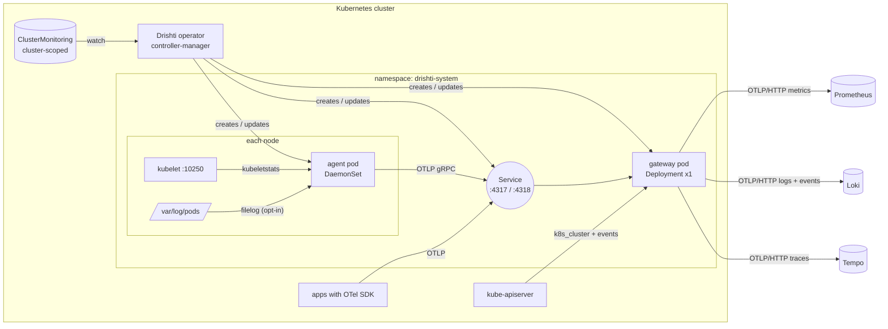
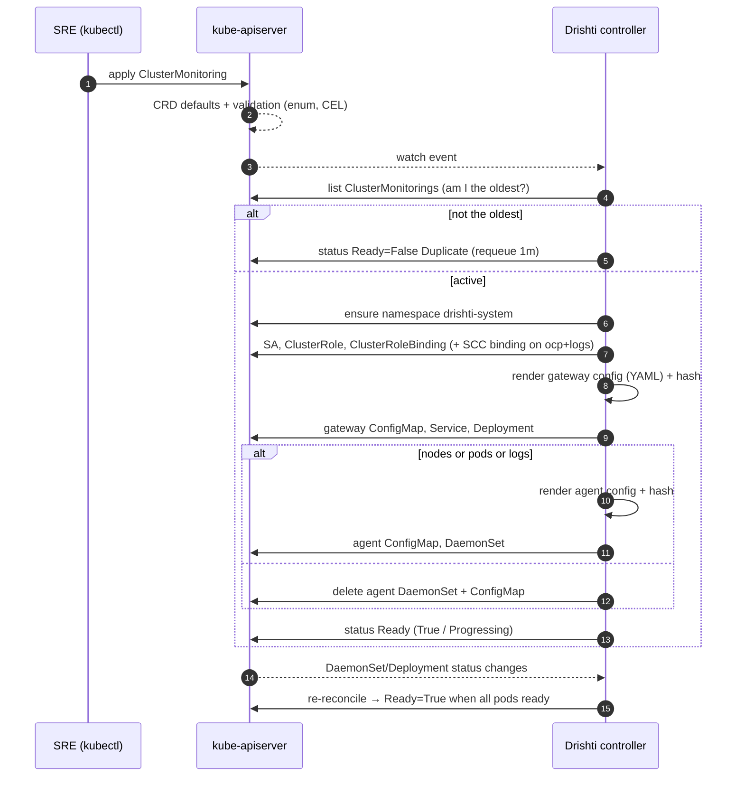

# Drishti operator: `ClusterMonitoring`

A Kubernetes operator built with [Kubebuilder](https://book.kubebuilder.io) that sets up logs and metrics collection for a whole cluster from one small custom resource.

You write this:

```yaml
apiVersion: monitoring.drishti.io/v1alpha1
kind: ClusterMonitoring
metadata:
  name: hlr-gke-prod
spec:
  platform: gke
  clusterName: hlr-gke-prod
```

Drishti then creates:

| What | Kind | Purpose |
|---|---|---|
| `<name>-agent` | DaemonSet (one pod per node) | Node + pod + container metrics from the kubelet; container logs (opt-in) |
| `<name>-gateway` | Deployment (1 replica) + Service | Cluster-level metrics, Kubernetes events, OTLP gateway for apps; the only component that talks to the backend |
| `<name>-collector` | ServiceAccount + ClusterRole + ClusterRoleBinding | Read-only API access for the collectors |

The full annotated example is [yaml/cluster.yml](yaml/cluster.yml).

---

## Quick start

Local development from zero to dashboards. Run everything in **WSL**, from the repo root, with the tools in [1. Prerequisites](#1-prerequisites-wsl) installed and Docker Desktop running.

**Terminal 1: cluster, backends, operator**

```bash
cd /mnt/d/rupam/go/kubernetes-operator

# 1. Local cluster: 1 control plane + 2 workers. This also creates the "kind" Docker network.
kind create cluster --name drishti --config yaml/kind-config.yaml

# 2. Prometheus, Loki, Tempo and Grafana on the "kind" network (data is in memory only)
docker compose -f demo/infrastructure/docker-compose.yaml up -d

# 3. Point the operator at those backends
export DRISHTI_METRICS_ENDPOINT=http://prometheus:9090/api/v1/otlp DRISHTI_LOGS_ENDPOINT=http://loki:3100/otlp DRISHTI_TRACES_ENDPOINT=http://tempo:4318

# 4. Install the CRD and run the operator from source (keep this terminal open)
make install run
```

**Terminal 2: turn on monitoring and look at the data**

```bash
cd /mnt/d/rupam/go/kubernetes-operator

# 5. Ask for monitoring of this cluster
kubectl apply -f yaml/cluster.yml

# 6. Wait until READY is True (about a minute: images are pulled first)
kubectl get cmon -w

# 7. The collectors: 3 agents (one per node) + 1 gateway
kubectl -n drishti-system get pods -o wide

# 8. Metrics have reached Prometheus
curl -s 'http://localhost:9090/api/v1/query?query=count(k8s_node_cpu_usage)' ; echo
```

Open **Grafana at http://localhost:3000** (no login) → **Explore**:

- Prometheus: `k8s_node_memory_working_set_bytes`
- Loki (needs `events: true` or `logs: true` in the CR): `{k8s_cluster_name="hlr-gke-prod"}`

**After changing Go code:** press Ctrl+C in terminal 1, then `make run` again. After changing `*_types.go`, run `make manifests generate install run`.

**Clean up**

```bash
kubectl delete -f yaml/cluster.yml                              # removes every collector
docker compose -f demo/infrastructure/docker-compose.yaml down  # stops the backends, data is discarded
kind delete cluster --name drishti
```

The rest of this README explains each step in detail: [4. Run on a local kind cluster](#4-run-on-a-local-kind-cluster) and [5.1 Local stack](#51-local-stack-prometheus-loki-tempo-and-grafana).

---

## Contents

0. [Quick start](#quick-start)
1. [Prerequisites (WSL)](#1-prerequisites-wsl)
2. [How this project was scaffolded](#2-how-this-project-was-scaffolded)
3. [Build and test](#3-build-and-test)
4. [Run on a local kind cluster](#4-run-on-a-local-kind-cluster)
5. [Send data to a real backend](#5-send-data-to-a-real-backend)
6. [Design document](#6-design-document)
7. [How it works: reconcile loop](#7-how-it-works-reconcile-loop)
8. [API reference](#8-api-reference)
9. [Troubleshooting](#9-troubleshooting)
10. [Project layout](#10-project-layout)

---

## 1. Prerequisites (WSL)

Run every command in this README inside **WSL (Ubuntu)**, not in PowerShell or cmd. The repo lives on the Windows drive and is reached from WSL at `/mnt/d/rupam/go/kubernetes-operator`.

| Tool | Version used | Check |
|---|---|---|
| Go | 1.26+ (tested with 1.27.3) | `go version` |
| Kubebuilder | v4.16.0 | `kubebuilder version` |
| kind | any recent | `kind version` |
| kubectl | matches cluster (1.37) | `kubectl version --client` |
| Docker | Docker Desktop with WSL integration | `docker ps` |
| make | GNU make | `make --version` |

### 1.1 Fix Go on the PATH

Go is installed at `/usr/local/go`. `~/.bashrc` currently sets `GOPATH=/usr/local/go`, which is the Go **install** directory (GOROOT), not a workspace, and Go ignores it with a warning. Replace it:

```bash
sed -i 's|^export GOPATH=/usr/local/go$|export GOPATH=$HOME/go|' ~/.bashrc
cat >> ~/.bashrc <<'EOF'
export PATH=/usr/local/go/bin:$HOME/go/bin:$PATH
EOF
source ~/.bashrc
go version
```

### 1.2 Install kubectl

```bash
curl -LO "https://dl.k8s.io/release/$(curl -Ls https://dl.k8s.io/release/stable.txt)/bin/linux/amd64/kubectl"
sudo install -m 0755 kubectl /usr/local/bin/kubectl && rm kubectl
kubectl version --client
```

### 1.3 Make Docker usable from WSL

kind needs Docker. In **Docker Desktop → Settings → Resources → WSL integration**, turn on the integration for `Ubuntu-20.04`, click *Apply & restart*, then in a new WSL shell:

```bash
docker ps        # must not say "could not be found in this WSL 2 distro"
```

### 1.4 Install kind and kubebuilder (if missing)

```bash
# kind
curl -Lo ./kind https://kind.sigs.k8s.io/dl/latest/kind-linux-amd64
sudo install -m 0755 kind /usr/local/bin/kind && rm kind

# kubebuilder
curl -L -o kubebuilder "https://go.kubebuilder.io/dl/latest/$(go env GOOS)/$(go env GOARCH)"
sudo install -m 0755 kubebuilder /usr/local/bin/kubebuilder && rm kubebuilder
```

---

## 2. How this project was scaffolded

You don't need to run these again. They are recorded so the project can be rebuilt from nothing.

```bash
cd /mnt/d/rupam/go/kubernetes-operator

# Go module + manager + kustomize config. Project name "drishti" gives the
# namespace drishti-system and the name prefix drishti-.
kubebuilder init \
  --domain drishti.io \
  --repo github.com/hdfc/drishti-operator \
  --project-name drishti

# Cluster-scoped API (one per cluster, no namespace) + controller.
kubebuilder create api \
  --group monitoring --version v1alpha1 --kind ClusterMonitoring \
  --namespaced=false --resource --controller
```

That produces `apiVersion: monitoring.drishti.io/v1alpha1, kind: ClusterMonitoring`, which matches [yaml/cluster.yml](yaml/cluster.yml).

The hand-written code is:

- [api/v1alpha1/clustermonitoring_types.go](api/v1alpha1/clustermonitoring_types.go): the spec/status schema, validation and defaults
- [internal/controller/](internal/controller/): the reconciler and everything it generates
- [cmd/main.go](cmd/main.go): install-time flags and the cache filter
- [config/manager/manager.yaml](config/manager/manager.yaml): env vars for the defaults, plus the namespace Pod Security label

---

## 3. Build and test

```bash
cd /mnt/d/rupam/go/kubernetes-operator

make manifests   # regenerate CRD + RBAC from the // +kubebuilder markers
make generate    # regenerate zz_generated.deepcopy.go
make build       # go build -> bin/manager
make test        # unit tests + envtest (real kube-apiserver + etcd, no nodes)
```

`make test` downloads envtest binaries into `bin/` on first run. Expected result:

```
ok  github.com/hdfc/drishti-operator/internal/controller  ... coverage: 82% of statements
```

What the tests cover:

- **CRD defaulting**: an empty `collect: {}` becomes `nodes/pods/events: true, logs: false`, and `collectionInterval: 30s`
- **Reconcile**: DaemonSet, Deployment, Service, ConfigMaps, ClusterRole/Binding are created with owner references; `Ready=False/Progressing` is reported (envtest runs no pods)
- **Toggles**: turning off nodes, pods and logs deletes the agent DaemonSet
- **Singleton**: a second ClusterMonitoring is marked `DuplicateClusterMonitoring` and creates nothing
- **Config rendering**: pipelines per toggle, self-log exclusion, the debug-exporter fallback, per-signal destination override

> Building on `/mnt/d` is slower than on the Linux filesystem. For faster builds, clone into `~/src` inside WSL.

---

## 4. Run on a local kind cluster

### 4.1 Create the cluster

```bash
kind create cluster --name drishti --config yaml/kind-config.yaml
kubectl get nodes          # 1 control-plane + 2 workers
```

### 4.2 Option A: run the operator from your shell (fastest loop)

```bash
make install               # applies the CRD only
make run                   # runs the controller locally against ~/.kube/config
```

The controller creates the `drishti-system` namespace itself if it is missing. Leave it running and open a second WSL terminal for the next steps.

### 4.3 Option B: deploy the operator into the cluster

```bash
make docker-build IMG=drishti-operator:dev
kind load docker-image drishti-operator:dev --name drishti
make deploy IMG=drishti-operator:dev

kubectl -n drishti-system get deploy drishti-controller-manager
kubectl -n drishti-system logs deploy/drishti-controller-manager -f
```

### 4.4 Apply the ClusterMonitoring

```bash
kubectl apply -f yaml/cluster.yml
# or, with logs enabled:
# kubectl apply -f config/samples/monitoring_v1alpha1_clustermonitoring.yaml
```

### 4.5 Verify

```bash
kubectl get clustermonitoring          # short name: kubectl get cmon
# NAME           PLATFORM   CLUSTER        ENV    READY   AGE
# hlr-gke-prod   gke        hlr-gke-prod   prod   True    1m

kubectl get cmon hlr-gke-prod -o wide  # adds the status message column
kubectl get cmon hlr-gke-prod -o jsonpath='{.status.conditions}' ; echo

kubectl -n drishti-system get ds,deploy,svc,cm,sa -l app.kubernetes.io/managed-by=drishti
kubectl get clusterrole,clusterrolebinding -l app.kubernetes.io/managed-by=drishti

# The rendered OpenTelemetry configs
kubectl -n drishti-system get cm hlr-gke-prod-agent   -o jsonpath='{.data.config\.yaml}'
kubectl -n drishti-system get cm hlr-gke-prod-gateway -o jsonpath='{.data.config\.yaml}'
```

With no backend configured, the gateway uses the OTel `debug` exporter, so data shows up in its logs:

```bash
kubectl -n drishti-system logs deploy/hlr-gke-prod-gateway -f
# ... Metrics {"kind": "exporter", "data_type": "metrics", "name": "debug", "resource metrics": 12, ...}
# ... Logs    {"kind": "exporter", "data_type": "logs",    "name": "debug", "log records": 7, ...}
```

### 4.6 Try changes and see the operator react

```bash
# Turn on logs: the agent rolls (config hash changes) and mounts /var/log/pods
kubectl patch cmon hlr-gke-prod --type merge -p '{"spec":{"collect":{"logs":true}}}'

# Turn off everything node-local: the agent DaemonSet is deleted
kubectl patch cmon hlr-gke-prod --type merge -p '{"spec":{"collect":{"nodes":false,"pods":false,"logs":false}}}'

# Deleting a child is self-healing: it is recreated within seconds
kubectl -n drishti-system delete deploy hlr-gke-prod-gateway

# clusterName is immutable (CEL rule)
kubectl patch cmon hlr-gke-prod --type merge -p '{"spec":{"clusterName":"other"}}'
# The ClusterMonitoring "hlr-gke-prod" is invalid: spec.clusterName: Invalid value: "string": clusterName is immutable
```

### 4.7 Clean up

```bash
kubectl delete -f yaml/cluster.yml     # garbage-collects every child (owner references)
make undeploy                          # if you used Option B
make uninstall                         # removes the CRD
kind delete cluster --name drishti
```

### 4.8 Check the collector configs offline (optional)

To check the generated configs against the exact collector version without a cluster, download `otelcol-contrib` v0.120.0 and validate them:

```bash
mkdir -p ~/otel && cd ~/otel
curl -sSLO https://github.com/open-telemetry/opentelemetry-collector-releases/releases/download/v0.120.0/otelcol-contrib_0.120.0_linux_amd64.tar.gz
tar xzf otelcol-contrib_0.120.0_linux_amd64.tar.gz otelcol-contrib
kubectl -n drishti-system get cm hlr-gke-prod-gateway -o jsonpath='{.data.config\.yaml}' > gateway.yaml
./otelcol-contrib validate --config=gateway.yaml
```

---

## 5. Send data to a real backend

Backends are install-time settings, the "Helm values". SREs normally don't set them in the CR.

| Signal | Env var on the manager | Flag | Example |
|---|---|---|---|
| metrics | `DRISHTI_METRICS_ENDPOINT` | `--default-metrics-endpoint` | `http://prometheus:9090/api/v1/otlp` |
| logs | `DRISHTI_LOGS_ENDPOINT` | `--default-logs-endpoint` | `http://loki:3100/otlp` |
| traces | `DRISHTI_TRACES_ENDPOINT` | `--default-traces-endpoint` | `http://tempo:4318` |
| environment | `DRISHTI_DEFAULT_ENVIRONMENT` | `--default-environment` | `prod` |
| collector image | `DRISHTI_COLLECTOR_IMAGE` | `--collector-image` | `otel/opentelemetry-collector-contrib:0.120.0` |

Set them permanently in [config/manager/manager.yaml](config/manager/manager.yaml), or on a running install:

```bash
kubectl -n drishti-system set env deploy/drishti-controller-manager \
  DRISHTI_METRICS_ENDPOINT=http://prometheus:9090/api/v1/otlp \
  DRISHTI_LOGS_ENDPOINT=http://loki:3100/otlp \
  DRISHTI_TRACES_ENDPOINT=http://tempo:4318
```

With `make run`, export the same variables before starting.

**Precedence, per signal:** `spec.destination.<signal>` in the CR, then the install-time default, then the `debug` exporter (stdout). One cluster can override only `metrics` and keep the default `logs`.

**Backend notes**

- *Prometheus 3.x*: start it with `--web.enable-otlp-receiver`; the base URL is `/api/v1/otlp` and the collector appends `/v1/metrics`. The gateway copies `k8s.cluster.name` and `deployment.environment` onto every datapoint, so they appear as `k8s_cluster_name` / `deployment_environment` labels. Pod, namespace and node names are resource attributes: list them under `otlp.promote_resource_attributes` in `prometheus.yml` to get them as labels.
- *Loki 3.x*: native OTLP at `/otlp`. Needs `allow_structured_metadata: true` (the default with schema v13).
- *Tempo*: OTLP/HTTP on port 4318; the collector appends `/v1/traces`. Drishti collects no traces itself: Tempo receives what apps send to the gateway Service.

### 5.1 Local stack: Prometheus, Loki, Tempo and Grafana

[demo/infrastructure/](demo/infrastructure/) runs all four backends with Docker Compose next to the kind cluster:

| Service | Receives | Browser |
|---|---|---|
| Prometheus | metrics (OTLP) | http://localhost:9090 |
| Loki | logs and Kubernetes events (OTLP) | http://localhost:3100/ready |
| Tempo | traces (OTLP) | http://localhost:3200/ready |
| Grafana | nothing, it queries the other three | http://localhost:3000 (no login) |

No extra OpenTelemetry Collector runs in Compose: the Drishti gateway is already one and sends OTLP straight to the backends.

Every service joins the `kind` Docker network. kind makes Docker's DNS available to pods, so the gateway reaches them by name (`prometheus`, `loki`, `tempo`). The `kind` network exists only after a kind cluster is created, so start the cluster first.

```bash
# 1. Cluster (4.1), then the backends
docker compose -f demo/infrastructure/docker-compose.yaml up -d
docker compose -f demo/infrastructure/docker-compose.yaml ps     # all "running" / tempo-init "exited (0)"

# 2. Operator with the backends as install-time defaults (Option A)
export DRISHTI_METRICS_ENDPOINT=http://prometheus:9090/api/v1/otlp
export DRISHTI_LOGS_ENDPOINT=http://loki:3100/otlp
export DRISHTI_TRACES_ENDPOINT=http://tempo:4318
make install run
```

For Option B, use the `kubectl set env` command above after `make deploy`. If the operator is already running, restart it with the variables set; the gateway rolls to the new config on the next reconcile.

Check that data arrives:

```bash
# The gateway config now has otlphttp exporters instead of debug
kubectl -n drishti-system get cm hlr-gke-prod-gateway -o jsonpath='{.data.config\.yaml}' | grep -A1 otlphttp

# The gateway can reach the backends (no "connection refused" / "no such host")
kubectl -n drishti-system logs deploy/hlr-gke-prod-gateway | grep -i error

# Metrics in Prometheus
curl -s 'http://localhost:9090/api/v1/query?query=count(k8s_node_cpu_usage)' ; echo
```

Then in Grafana (http://localhost:3000 → **Explore**):

- **Prometheus**: `k8s_node_memory_working_set_bytes`, or `sum by (k8s_pod_name) (k8s_pod_cpu_usage{k8s_namespace_name="drishti-system"})`
- **Loki** (with `collect.events: true` and/or `collect.logs: true`): `{k8s_cluster_name="hlr-gke-prod"}`
- **Tempo**: search for traces sent by your apps to `hlr-gke-prod-gateway.drishti-system.svc:4318`

Stop the stack with `docker compose -f demo/infrastructure/docker-compose.yaml down`. Nothing is persisted: every service keeps its data in `tmpfs` (memory), so it is discarded whenever a container stops, including when Docker Desktop restarts. The containers come back empty on their own (`restart: unless-stopped`); Grafana re-provisions its datasources on every start.

---

## 6. Design document

### 6.1 Goal

Give an SRE one object per cluster that turns on standard logs and metrics collection, with good defaults and no knowledge of backend URLs or OTel internals. Keep platform differences (GKE, EKS, OpenShift) inside the operator.

**Non-goals for v1alpha1:** dashboards and alerts, per-application instrumentation, auto-injecting SDKs, tracing collection from nodes, multi-tenancy inside one cluster.

### 6.2 Architecture



### 6.3 The two collectors

Both run the **OpenTelemetry Collector contrib** image. They differ only in the config the operator writes.

**Agent (DaemonSet), node-local work only**

| Receiver | Enabled by | Produces |
|---|---|---|
| `kubeletstats` | `collect.nodes` (group `node`), `collect.pods` (groups `pod`, `container`) | CPU, memory, filesystem and network per node, pod and container, read from the local kubelet at `https://$K8S_NODE_IP:10250` using the SA token |
| `filelog` | `collect.logs` | Every container log line under `/var/log/pods/*/*/*.log`, parsed by the `container` operator (docker / containerd / cri-o). The agent's own logs are excluded to prevent a feedback loop. |

Processors: `memory_limiter` → `k8sattributes` (adds deployment / statefulset / daemonset / job names, watching only pods on its own node) → `batch`. Exporter: OTLP gRPC to the gateway Service.

**Gateway (Deployment, exactly 1 replica), cluster-wide work and egress**

| Receiver | Enabled by | Produces |
|---|---|---|
| `otlp` | always | Receives agent data and any app's OTLP traffic (4317 gRPC / 4318 HTTP) |
| `k8s_cluster` | `collect.nodes` or `collect.pods` | Object state: pod phase, container restarts, node conditions, deployment desired/available, and more. `distribution: openshift` on OCP adds ClusterResourceQuota metrics. |
| `k8sobjects` | `collect.events` | Kubernetes events (`events.k8s.io`) in watch mode, as log records |

Processors: `memory_limiter` → `resource/cluster` (upserts `k8s.cluster.name`, `deployment.environment`) → `transform/labels` (metrics only: copies them onto each datapoint) → `batch`. Exporters: one `otlphttp/<signal>` per configured backend, otherwise `debug`.

**Why a gateway instead of agents exporting directly?**

- Only one component knows backend URLs and credentials, so changing a backend restarts 1 pod instead of N.
- `k8s_cluster` and `k8sobjects` must run once per cluster, or every node would report the same cluster state. They need a singleton anyway.
- Cluster labels are stamped in one place.

**Why one replica?** Two gateways would both run `k8s_cluster` / `k8sobjects` and double every cluster metric and event. Scaling out the OTLP path is a future change: split it into a separate, horizontally scaled Deployment.

### 6.4 Key design decisions

| Decision | Why |
|---|---|
| **Cluster-scoped CRD** | "Monitor this cluster" has no natural namespace. RBAC for creating it can be limited to platform admins with a ClusterRole. |
| **One active CR per cluster** | Two would create two sets of collectors and duplicate all data. The oldest CR (by `creationTimestamp`, then name) wins. The others get `Ready=False, reason=DuplicateClusterMonitoring` and are re-checked every minute, so a duplicate takes over if the active one is deleted. CRD validation can't enforce a singleton, so the controller does. |
| **`platform` is required, not auto-detected** | A wrong guess (for example missing the OpenShift SCC) silently breaks collection. Asking costs one line. |
| **`clusterName` is required and immutable** | Kubernetes has no reliable "friendly name" for itself. Renaming would split every time series in two, so a CEL rule (`self == oldSelf`) blocks it. |
| **Booleans are `*bool` with CRD defaults** | With a plain `bool` + `omitempty`, an explicit `false` is dropped on serialisation and the server default `true` comes back. Pointers keep "unset" and "false" apart. The `+kubebuilder:default={}` on `collect` makes the nested defaults apply even when `collect` is omitted. |
| **Install-time defaults + CR overrides** | SREs shouldn't need backend URLs. Platform teams set them once (env vars / Helm values). The CR overrides only when one cluster must differ. |
| **Owner references on every child** | Deleting the CR garbage-collects everything, including cluster-scoped RBAC. A namespaced child may point at a cluster-scoped owner. No finalizer is needed. |
| **Config hash annotation on pod templates** | Collectors don't reload ConfigMaps. A changed config changes `drishti.io/config-hash`, which triggers a normal rolling update. |
| **Requests = limits (Guaranteed QoS)** | `memory_limiter` uses the cgroup limit (80%) to shed load before an OOM-kill, and the scheduler reserves what the collector actually uses. |
| **Label-filtered manager cache** | The manager only caches ConfigMaps, Services, Deployments and so on that carry `app.kubernetes.io/managed-by=drishti`. Without this it would cache every such object in the cluster. |
| **Collectors run in the operator namespace** | One place for RBAC, Pod Security labels and network policy. `ensureNamespace` creates it for `make run`, and the operator never deletes it. |

### 6.5 Platform differences

| | GKE | EKS | OpenShift (ocp) |
|---|---|---|---|
| kubelet endpoint | `https://<hostIP>:10250`, `insecure_skip_verify` (self-signed kubelet certs) | same | same |
| agent pod user | UID 10001 | UID 10001 | UID left to the SCC (restricted-v2 assigns one from the namespace range) |
| logs on | root + read-only hostPath `/var/log/pods` | same | additionally `privileged: true` (SELinux), and the SA is bound to `system:openshift:scc:privileged` |
| `k8s_cluster` | default | default | `distribution: openshift` (+ `clusterresourcequotas` read RBAC) |
| default sizes (agent / gateway) | 200m, 256Mi / 500m, 1Gi | 200m, 256Mi / 500m, 1Gi | 250m, 384Mi / 500m, 1Gi |

### 6.6 Security and RBAC

- **Collector ClusterRole** (`drishti:<name>:collector`) is read-only (`get/list/watch`): nodes, `nodes/stats`, `nodes/proxy`, pods, namespaces, events, services, endpoints, RCs, quotas, PVs, PVCs; apps/*; batch/*; HPAs; `events.k8s.io` events; plus OpenShift quotas on `ocp`.
- **Operator role**: Kubernetes RBAC refuses to let a subject grant permissions it doesn't hold (escalation prevention). The operator's [role.yaml](config/rbac/role.yaml), generated from the `+kubebuilder:rbac` markers, therefore includes those read rules too, plus `use` on the `privileged` SCC (OpenShift only) so it can create that binding. It doesn't use the `escalate` or `bind` verbs.
- **Pod security**: the gateway, and the agent without logs, run non-root, with a read-only root filesystem, all capabilities dropped and `RuntimeDefault` seccomp. Log collection needs root and a hostPath mount, so the collector namespace is labelled `pod-security.kubernetes.io/enforce: privileged`.
- **Transport**: agent → gateway is in-cluster plaintext gRPC. Add mTLS or a NetworkPolicy if your threat model needs it.

### 6.7 Status

```yaml
status:
  observedGeneration: 3
  conditions:
    - type: Ready
      status: "True"
      reason: AllComponentsRunning
      message: "2 collectors created"
```

| reason | status | meaning |
|---|---|---|
| `AllComponentsRunning` | True | Gateway available, and every scheduled agent pod is updated and ready |
| `Progressing` | False | Rolling out, for example `gateway ready, agent 2/3 nodes ready; 2 collectors created` |
| `ReconcileError` | False | An API call failed. The message has the error and the reconcile is retried with backoff. |
| `DuplicateClusterMonitoring` | False | Another ClusterMonitoring is active. This one does nothing. |

Changes to owned DaemonSet/Deployment status re-trigger reconcile, so `Ready` follows pod health without polling. Status is only written when it changes, so the controller doesn't loop on its own writes.

### 6.8 Known limitations / next steps

- Log tailing starts `at: end` with no checkpoint storage, so lines written while an agent pod restarts are lost. Next step: the `file_storage` extension on a hostPath.
- The gateway is a single replica, so there is a short gap during its rollout.
- No admission webhook yet. Validation is CRD schema + CEL only.
- If a child object with the same name already exists without the `managed-by=drishti` label, it is not adopted and reconcile reports an `AlreadyExists` error.
- Not yet: dashboards, alerts, and a Helm chart.

---

## 7. How it works: reconcile loop



Every object is written with `controllerutil.CreateOrUpdate` and a controller owner reference, so the loop is **idempotent**: running it 1 or 100 times gives the same result. Manual edits or deletes of children are reverted on the next event.

Step by step for `kubectl apply -f yaml/cluster.yml`:

1. The API server fills defaults (`logs: false`, `collectionInterval: 30s`, and so on), checks `platform ∈ {gke,eks,ocp}`, and stores the object.
2. The controller receives the event and checks it is the only (oldest) ClusterMonitoring.
3. It resolves effective settings: environment (CR → `--default-environment`), destination per signal (CR → install default → debug), and sizes (CR → platform default).
4. It renders the two OTel configs from the toggles, writes them to ConfigMaps, and stamps their hash on the pod templates.
5. Kubernetes schedules one agent per node and one gateway. The agents scrape the kubelet every `collectionInterval` and forward to the gateway, which adds cluster metrics and events, labels everything with `k8s.cluster.name=hlr-gke-prod`, `deployment.environment=prod`, and exports.
6. When pods become ready, the owned-object watch fires again and the status turns `Ready=True: 2 collectors created`.
7. `kubectl delete cmon hlr-gke-prod` removes everything through owner-reference garbage collection.

---

## 8. API reference

`monitoring.drishti.io/v1alpha1`, `ClusterMonitoring`, cluster-scoped, short name `cmon`.

| Field | Type | Required | Default | Notes |
|---|---|---|---|---|
| `spec.platform` | `gke` \| `eks` \| `ocp` | yes | none | Selects platform-specific settings |
| `spec.clusterName` | string (1–63) | yes | none | Label on all data. **Immutable.** |
| `spec.environment` | string (≤63) | no | `--default-environment` (`dev`) | `deployment.environment` label |
| `spec.collect.nodes` | bool | no | `true` | kubeletstats `node` + k8s_cluster |
| `spec.collect.pods` | bool | no | `true` | kubeletstats `pod`, `container` + k8s_cluster |
| `spec.collect.events` | bool | no | `true` | k8sobjects events → logs pipeline |
| `spec.collect.logs` | bool | no | `false` | filelog on every node (root + hostPath) |
| `spec.collectionInterval` | duration | no | `30s` | kubeletstats + k8s_cluster interval |
| `spec.destination.metrics` | URL `^https?://` | no | install default | OTLP/HTTP base URL |
| `spec.destination.traces` | URL | no | install default | |
| `spec.destination.logs` | URL | no | install default | |
| `spec.collectorResources.perNode.{cpu,memory}` | quantity | no | per platform | Agent requests = limits |
| `spec.collectorResources.central.{cpu,memory}` | quantity | no | per platform | Gateway requests = limits |
| `status.observedGeneration` | int | | | |
| `status.conditions[type=Ready]` | Condition | | | See [6.7](#67-status) |

Full schema: [config/crd/bases/monitoring.drishti.io_clustermonitorings.yaml](config/crd/bases/monitoring.drishti.io_clustermonitorings.yaml), or run `kubectl explain clustermonitoring.spec --recursive`.

---

## 9. Troubleshooting

| Symptom | Check / fix |
|---|---|
| `docker: could not be found in this WSL 2 distro` | Turn on Docker Desktop WSL integration ([1.3](#13-make-docker-usable-from-wsl)) |
| `go: command not found` in WSL | Fix the PATH ([1.1](#11-fix-go-on-the-path)) |
| `Ready=False … agent 0/3 nodes ready` for a long time | `kubectl -n drishti-system describe ds hlr-gke-prod-agent` and look at pod events: image pull, PSA rejection, SCC |
| Agent pods `CrashLoopBackOff` | `kubectl -n drishti-system logs ds/hlr-gke-prod-agent`. The collector prints the invalid config key. |
| kubeletstats `401/403` | ClusterRole must include `nodes/stats` and `nodes/proxy`: `kubectl get clusterrole drishti:hlr-gke-prod:collector -o yaml` |
| `forbidden: ... attempting to grant RBAC permissions not currently held` | The operator role is out of date. Run `make manifests` then `make deploy`. |
| Pods rejected by Pod Security with `logs: true` | The namespace needs `pod-security.kubernetes.io/enforce=privileged` |
| `DuplicateClusterMonitoring` | `kubectl get cmon` and delete the extra one |
| Nothing reaches the backend | `kubectl -n drishti-system logs deploy/hlr-gke-prod-gateway` and look for exporter errors. Confirm the endpoint resolves from inside the cluster. |

---

## 10. Project layout

```
.
├── api/v1alpha1/
│   ├── clustermonitoring_types.go      # CRD schema, markers, defaults, helpers
│   └── zz_generated.deepcopy.go        # generated (make generate)
├── cmd/main.go                         # manager: flags/env defaults, label-filtered cache
├── internal/controller/
│   ├── clustermonitoring_controller.go # Reconcile, status, RBAC markers, watches
│   ├── collector_config.go             # renders agent + gateway OTel configs
│   ├── resources.go                    # SA / RBAC / ConfigMap / DaemonSet / Deployment / Service builders
│   ├── options.go                      # install-time defaults and precedence rules
│   ├── *_test.go                       # envtest + rendering tests
│   └── suite_test.go                   # envtest bootstrap (scaffolded)
├── config/
│   ├── crd/bases/                      # generated CRD (make manifests)
│   ├── rbac/role.yaml                  # generated operator ClusterRole
│   ├── manager/manager.yaml            # operator Deployment + env defaults
│   ├── default/                        # kustomize entry for make deploy (ns drishti-system)
│   └── samples/                        # example CR (logs on)
├── demo/infrastructure/                # docker compose: Prometheus, Loki, Tempo, Grafana (5.1)
├── yaml/
│   ├── cluster.yml                     # the annotated ClusterMonitoring this operator implements
│   └── kind-config.yaml                # 1 control-plane + 2 workers
├── test/e2e/                           # scaffolded kind-based e2e (make test-e2e)
├── Dockerfile
└── Makefile
```

Common `make` targets: `manifests`, `generate`, `fmt`, `vet`, `test`, `build`, `run`, `install`, `uninstall`, `docker-build`, `deploy`, `undeploy`, `test-e2e`, `lint`. Run `make help` for the full list.
